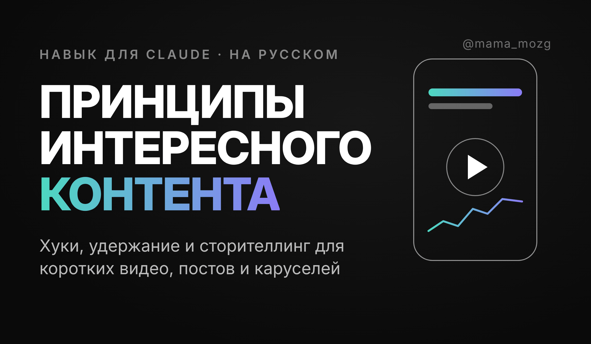
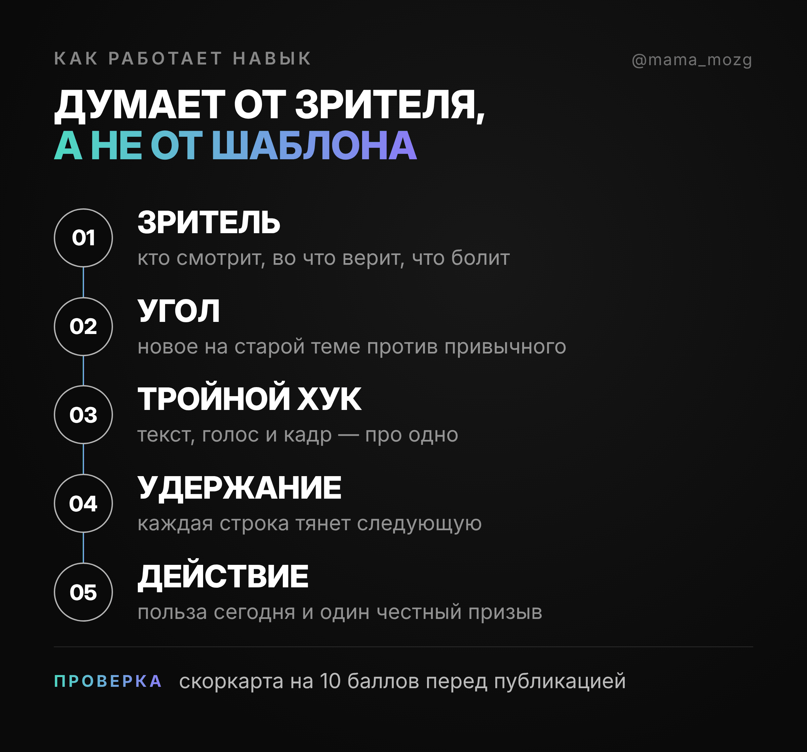
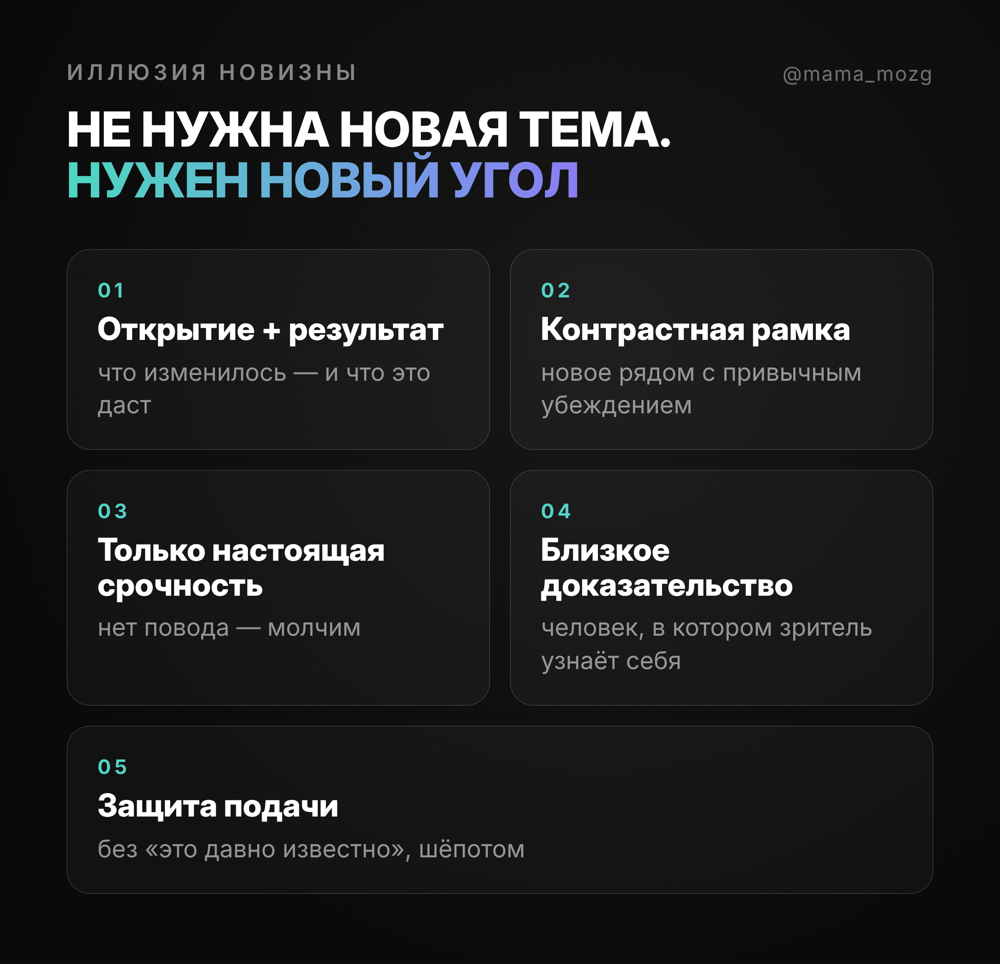
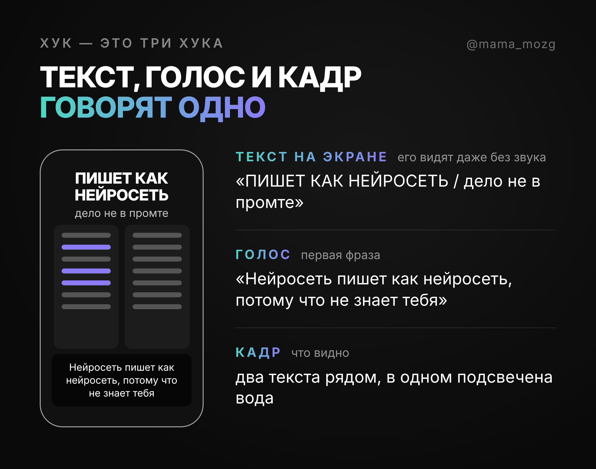
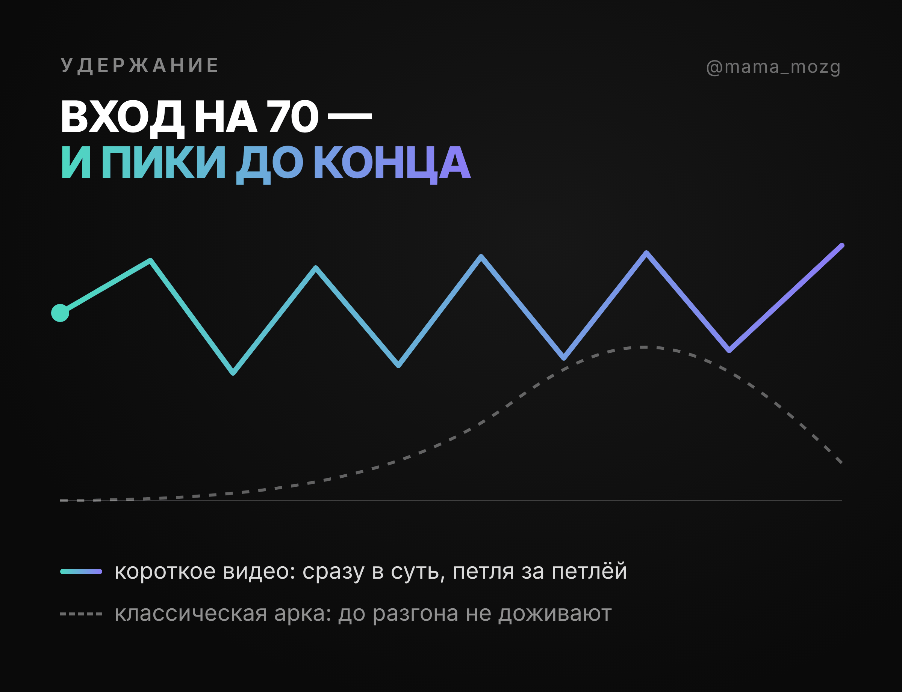
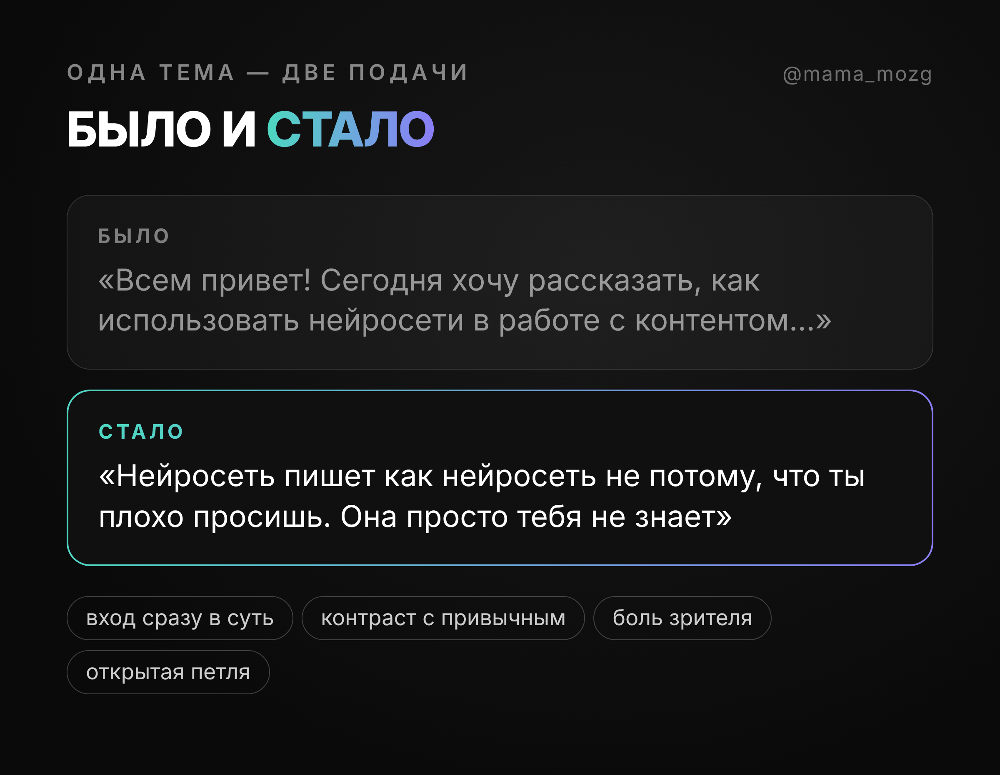
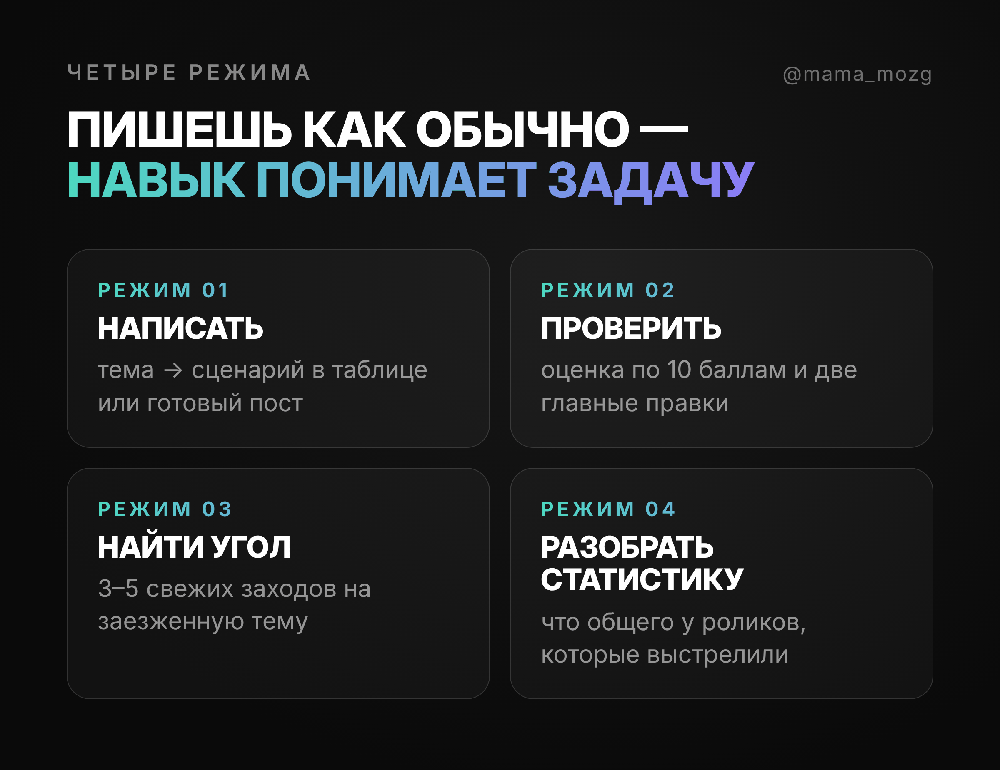

<p align="center">
  
</p>

<p align="center">
  <b>Навык для Claude, который делает контент интереснее.</b><br>
  Сценарии коротких видео, хуки, посты и карусели — на живом русском языке.
</p>

<p align="center">
  
  
  
</p>

---

## Зачем он нужен

Ты просишь нейросеть написать сценарий, и выходит одно и то же: «Всем привет, сегодня расскажу…», три пункта, «подписывайся». Такой ролик пролистывают на первой секунде — его уже видели сто раз.

Этот навык учит нейросеть думать как зритель, который листает ленту: что его остановит, во что он уже верит, на какой строке он уйдёт. Поэтому каждый сценарий получается своим, а не собранным по шаблону.

## Что ты получаешь

**Свежий угол на заезженной теме.** «Про это уже всё сказали» — не приговор. Навык найдёт, с какой стороны зайти, чтобы старое прозвучало как открытие.

**Хуки, которые останавливают палец.** Текст на экране, первая фраза и картинка работают вместе, а не каждый сам по себе.

**Ролики, которые досматривают.** Каждая строка тянет за собой следующую, польза появляется в первые секунды, а ближе к концу открывается новый вопрос.

**Живой русский язык.** Без «в современном мире», «давайте разберёмся» и прочих примет текста от нейросети.

**Честный контент.** Навык не выдумывает цифры, клиентов и срочность. Если чего-то не хватает, он ставит пометку `[НУЖНО: …]` и спрашивает.

**Контент, который продаёт.** Навык помнит, что просмотры — ещё не деньги, и подсказывает форматы, где экспертиза видна в деле, и призывы, которые алгоритмы не считают спамом.

<p align="center">
  
</p>

---

## На каких принципах он работает

Навык не даёт нейросети готовых формул. Он объясняет, как устроено внимание, и нейросеть каждый раз рассуждает заново.

**1. Три вопроса зрителя.** За полторы секунды человек решает: это про меня? я такого не слышал? хочу узнать, что дальше? Одно «нет» — и он листает.

**2. Один человек, а не «аудитория».** Текст пишется так, будто ты отправляешь его в личку одному конкретному человеку. Узнавание — через его ситуацию, а не через профессию.

**3. Новый угол вместо новой темы.** Пять способов сделать старое новым: дать явлению новое имя, сменить причину, поменять порядок, найти пропущенное обновление, перевернуть привычный совет.

<p align="center">
  
</p>

**4. Контраст с привычным.** Новая мысль ставится вплотную к тому, во что зритель верил раньше. Появляется зазор — а зазор и есть интрига.

**5. Строка продаёт строку.** Короткое видео смотрят построчно: если первая фраза не продала вторую, до третьей никто не дойдёт.

**6. Петли любопытства.** Вопрос открылся, закрылся, и тут же открылся следующий. Последняя петля не закрывается, пока не открыта новая.

**7. Тройной хук.** Текст на экране, голос и кадр должны говорить одно и то же. Расходятся хоть на полсекунды — зритель уходит.

<p align="center">
  
</p>

**8. Зона залипания.** Следующие 5–15 секунд после хука подтверждают обещание и дают повод поверить автору.

**9. Вход сразу в суть.** Никаких «привет» и долгих разгонов: зритель попадает в середину уже начавшейся истории, дальше пики идут один за другим.

<p align="center">
  
</p>

**10. Конкретика.** «45 дней назад» вместо «недавно», «20 минут вместо трёх часов» вместо «быстро». Конкретное видно, общее — нет.

**11. Просто о сложном.** Главную мысль можно пересказать подруге после одного просмотра. Термин — только с объяснением в той же строке.

**12. Без воды.** Всё, что не служит обещанию хука, уходит. Даже любимая фраза.

**13. Снятие возражений.** «Сейчас будет реклама курса», «это для айтишников», «у меня не сработает» — сомнение снимается одной фразой ровно там, где оно возникает.

**14. Злодей и герой.** Злодей — устаревший подход или привычка, против которой аудитория уже настроена. Герой — тот, в ком зритель узнаёт себя.

**15. Покажи, а не расскажи.** Лучше всего продают ролики, где экспертиза видна в действии: разбор, сборка вживую, механика реального кейса.

**16. Честность.** Никаких выдуманных фактов, фальшивой срочности и обещаний вирусности.

<p align="center">
  
</p>

---

## Четыре режима

<p align="center">
  
</p>

Режим выбирать не нужно — навык сам понимает задачу по просьбе:

- «Напиши рилс про то, как я собрала контент-план за вечер»
- «Дай 10 хуков для ролика про тревогу перед выступлением»
- «Проверь мой сценарий» — и вставь текст
- «Тема про нейросети уже всем надоела, найди угол»
- «Вот статистика моих последних роликов, что сработало?»

Сценарий видео приходит таблицей: **время — что в кадре — текст на экране — что говорим**. Её можно сразу отдавать на съёмку и монтаж.

---

## Как установить

**Claude Code или Codex.** Вставь ссылку на этот репозиторий в чат и напиши: «Установи этот навык».

**Claude.ai или приложение Claude.**
1. Скачай репозиторий: зелёная кнопка **Code** → **Download ZIP**, и распакуй.
2. Заархивируй в ZIP только папку `printsipy-interesnogo-kontenta`.
3. Открой Настройки → Возможности и проверь, что включено выполнение кода.
4. В разделе «Навыки» загрузи этот архив.

**ChatGPT.** Навык длиннее, чем помещается в инструкции своего GPT. Создай проект, загрузи в его файлы `SKILL.md` и всё из папки `references`, а в инструкциях проекта напиши: «Работай по файлу SKILL.md, остальные файлы — справочники к нему».

**DeepSeek и другие чаты.** Вставь текст `SKILL.md` первым сообщением и попроси работать по нему. Нужный справочник из `references` добавляй по ходу.

## Что внутри

```
printsipy-interesnogo-kontenta/
├── SKILL.md              главный файл: принципы и режимы
└── references/
    ├── novizna.md        угол и новизна
    ├── huki.md           хуки и первые 15 секунд
    ├── struktura.md      удержание, петли, сторителлинг
    ├── formaty.md        как выбрать формат под идею
    ├── prodazhi.md       от просмотров к заявкам
    ├── yazyk.md          живой русский без примет нейросети
    ├── proverka.md       скоркарта и разбор статистики
    └── primery.md        готовые примеры в сборе
```

---

<p align="center">
  Автор — <b>Маргарита Захарова</b> · <a href="https://www.instagram.com/mama_mozg">@mama_mozg</a><br>
  Больше про ИИ и контент — в Telegram: <a href="https://t.me/marketing_dir">t.me/marketing_dir</a>
</p>

<p align="center"><sub>Часть принципов навыка опирается на открытый проект <a href="https://github.com/aiwithremy/content-principles">content-principles</a>.</sub></p>
